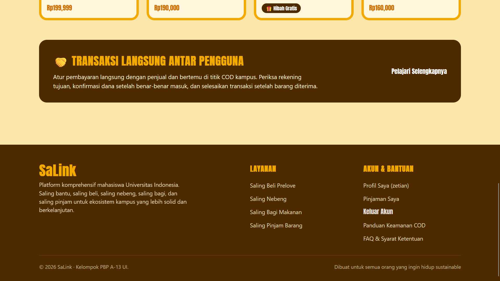
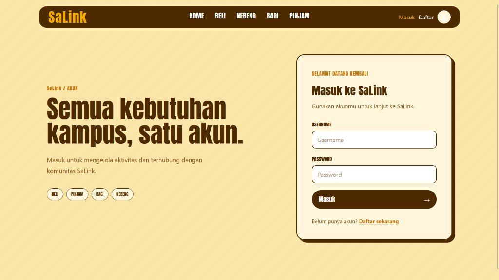
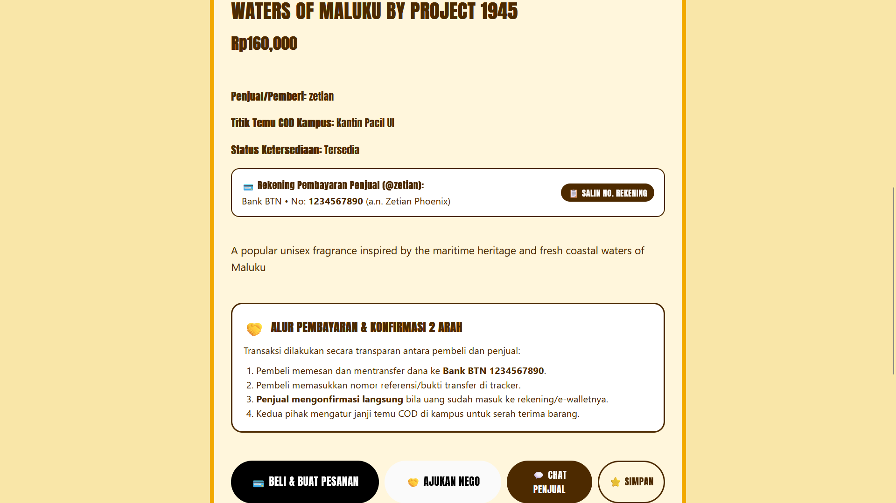
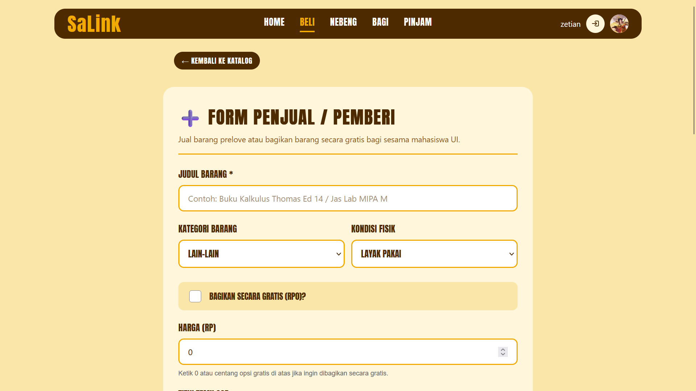
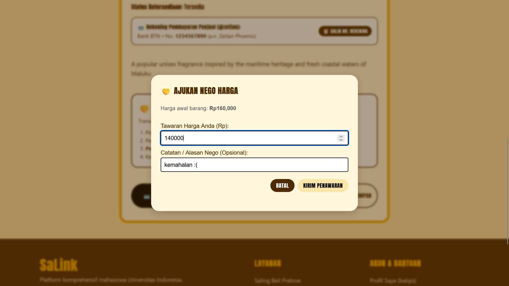
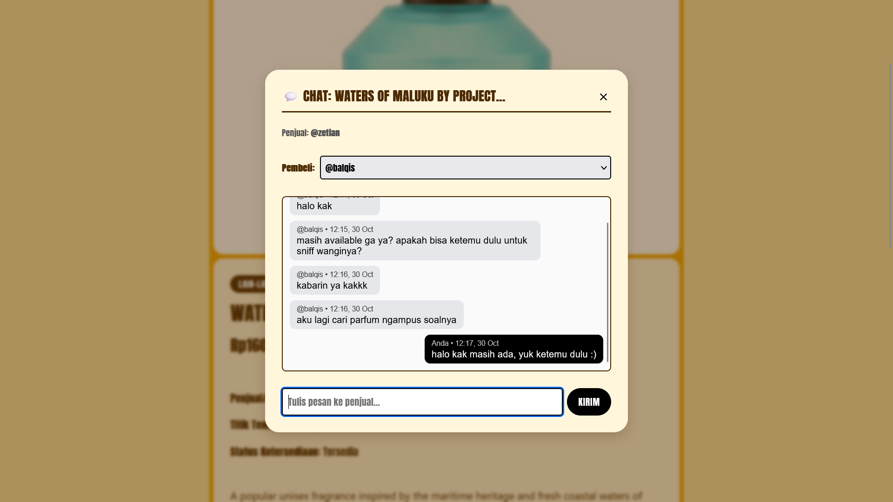
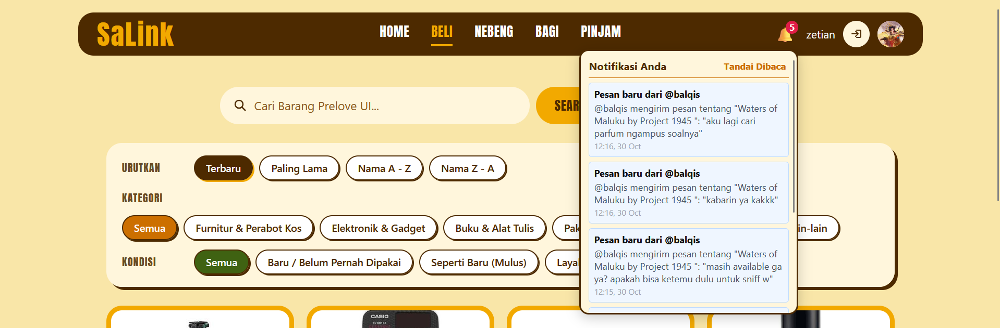
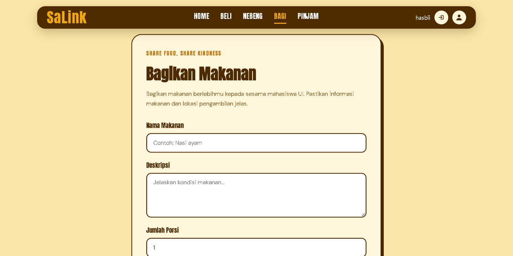
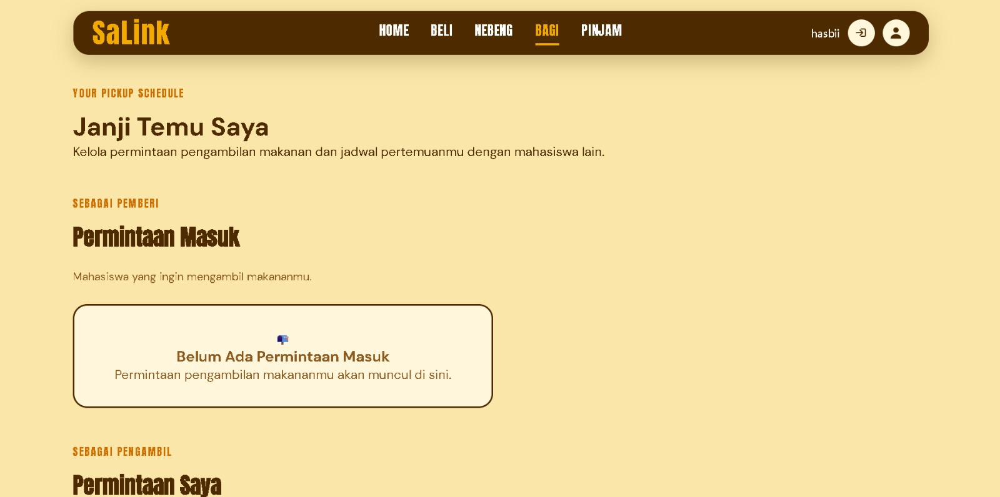

# SaLink Media

Kumpulan tangkapan layar produk SaLink untuk dokumentasi dan rilis. Semua gambar diambil
menggunakan data seed yang sudah dianonimkan.

> **Privasi:** jangan pernah memasukkan kredensial, cookie sesi, alamat email asli, nomor
> rekening, atau isi percakapan pribadi ke dalam folder ini. Tangkapan layar harus memakai
> akun dan barang demo.

## Daftar isi

- [Beranda](#beranda)
- [Autentikasi](#autentikasi)
- [Saling Beli](#saling-beli)
- [Panduan capture](#panduan-capture)

---

## Beranda

### Halaman utama (desktop)

*1024×576 — hero, ringkasan lima layanan, dan kartu modul.*

### Footer

*1920×1080 — footer global dengan tautan modul dan informasi kelompok.*

---

## Autentikasi

### Halaman login

*1024×576 — form login bersama yang dipakai semua modul, termasuk alur `?next=` kembali ke modul asal.*

---

## Saling Beli

### Katalog barang

*1920×1080 — pencarian, filter kategori/kondisi, pengurutan, tombol Tersimpan, dan grid barang.*

### Detail barang

*1920×1080 — foto, harga, kondisi, titik temu COD, aksi beli/nego/chat, serta tracker transaksi.*

### Form jual / hibah

*1920×1080 — form listing dengan unggah foto, kategori, kondisi, harga, dan rekening pencairan.*

### Nego harga

*1920×1080 — pengajuan tawaran dari pembeli dan daftar penawaran yang masuk ke penjual.*

### Chat penjual

*1920×1080 — percakapan per pembeli, dengan pemilih pembeli di sisi penjual.*

### Notifikasi in-app

*1918×631 — badge jumlah belum dibaca, daftar notifikasi, dan toast aktivitas baru.*

---

### Saling Bagi

### Halaman Saling Bagi

### Form Bagikan Makanan

### Janji Temu

### Demo Fitur Saling Bagi

<video width="100%" controls>
  <source src="salingbagi.mp4" type="video/mp4">
</video>

---

## Panduan capture

- Ukuran acuan: **1440×900** untuk desktop dan **390×844** untuk mobile.
- Nama berkas memakai huruf kecil dan tanda hubung, kecuali berkas yang sudah ada
  (contoh: `salingbeli-detailedProduct.png`). GitHub membedakan huruf besar/kecil.
- Untuk alur bergerak, simpan sebagai GIF pendek (maksimal ±5 MB) dengan nama seperti
  `auth-flow.gif` atau `saling-beli-flow.gif`.
- Bersihkan data pribadi sebelum menyimpan: ganti nama akun, nomor rekening, dan isi pesan
  dengan data dummy.
- Kompres PNG dengan alat seperti `pngquant` atau `oxipng` bila ukuran melebihi 500 KB.

---

*Dokumentasi ini adalah bagian dari repositori SaLink. Lihat [README utama](../../README.md)
untuk gambaran aplikasi dan cara menjalankan proyek.*
