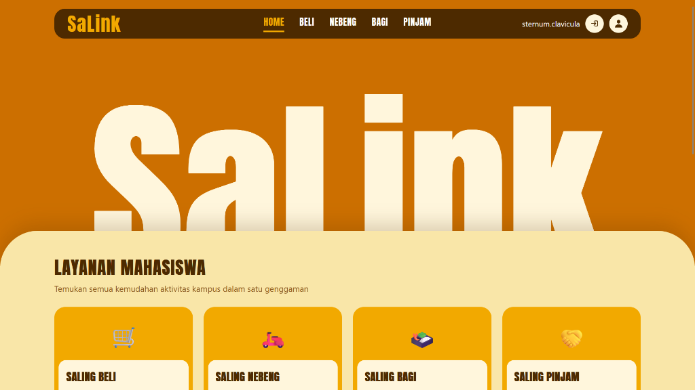
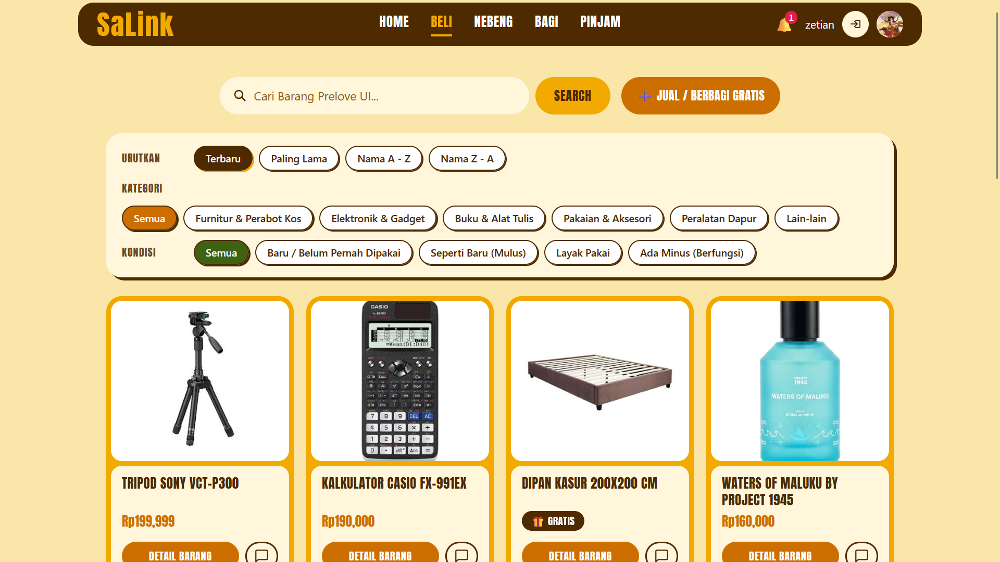
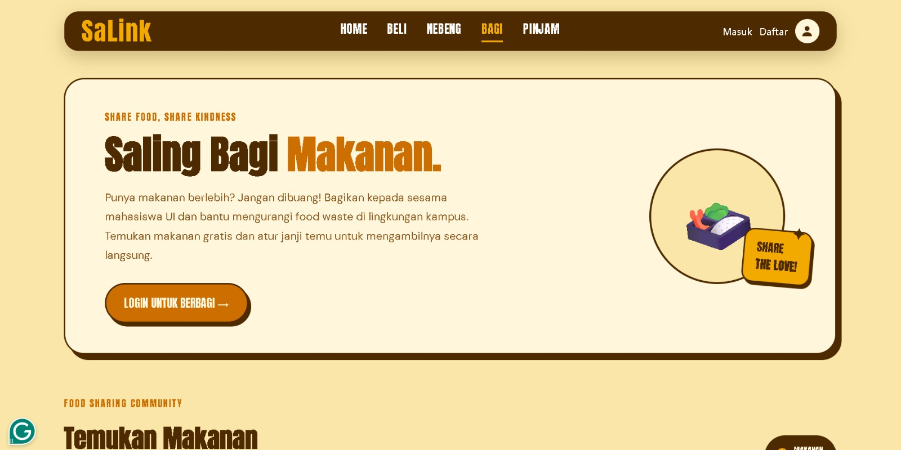
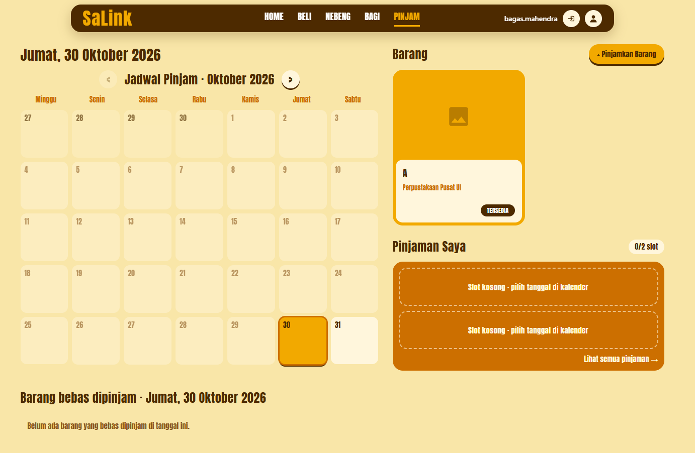
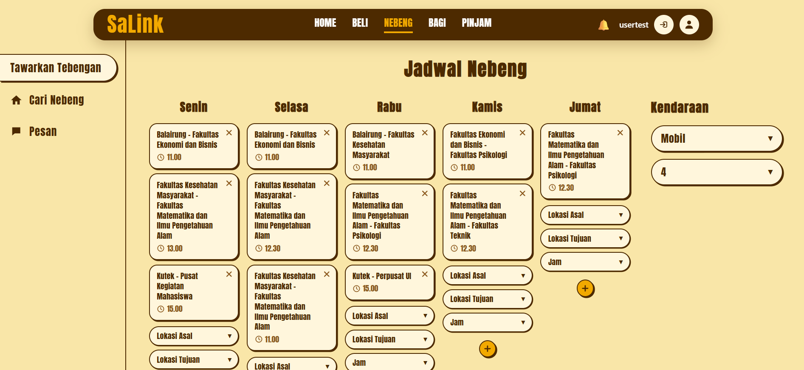

# Dokumentasi Media SaLink

Kumpulan screenshot dan video alur fitur SaLink. Semua media harus menggunakan data demo
yang sudah dianonimkan.

> **Privasi:** jangan masukkan password, cookie sesi, email asli, nomor rekening, atau isi
> chat pribadi ke dalam folder ini.

## Daftar Modul

- [Beranda dan autentikasi](#beranda-dan-autentikasi)
- [Saling Beli](#saling-beli)
- [Saling Bagi](#saling-bagi)
- [Saling Pinjam](#saling-pinjam)
- [Saling Tebeng](#saling-tebeng)
- [Panduan penamaan dan capture](#panduan-penamaan-dan-capture)

---

## Beranda dan Autentikasi

| Tampilan | File | Keterangan |
| --- | --- | --- |
| Homepage desktop | [`homepage-desktop.png`](homepage-desktop.png) | Hero, ringkasan layanan, dan kartu modul. |
| Footer global | [`footer-desktop.png`](footer-desktop.png) | Tautan modul dan informasi kelompok. |
| Login bersama | [`login-page.jpg`](login-page.jpg) | Login dengan dukungan parameter `next`. |

---

## Saling Beli

| Alur | File | Keterangan |
| --- | --- | --- |
| Katalog | [`salingbeli-page.png`](salingbeli-page.png) | Pencarian, filter, sorting, dan grid listing. |
| Detail barang | [`salingbeli-detailedProduct.png`](salingbeli-detailedProduct.png) | Detail produk, harga, COD, dan aksi transaksi. |
| Jual / hibah | [`salingbeli-form.png`](salingbeli-form.png) | Form listing, foto, kondisi, harga, dan rekening. |
| Nego | [`salingbeli-nego.png`](salingbeli-nego.png) | Pengajuan dan respons penawaran harga. |
| Chat | [`salingbeli-chat.png`](salingbeli-chat.png) | Percakapan per barang dan per pembeli. |
| Notifikasi | [`salingbeli-notifications.png`](salingbeli-notifications.png) | Badge dan daftar notifikasi transaksi/chat. |

---

## Saling Bagi

| Alur | File | Keterangan |
| --- | --- | --- |
| Daftar makanan | [`salingbagi-page.jpeg`](salingbagi-page.jpeg) | Etalase makanan berlebih yang tersedia. |
| Bagikan makanan | [`salingbagi-bagikanmakanan.jpeg`](salingbagi-bagikanmakanan.jpeg) | Form tambah makanan, porsi, lokasi, dan batas konsumsi. |
| Janji temu | [`salingbagi-janjitemu.jpeg`](salingbagi-janjitemu.jpeg) | Koordinasi pengambilan makanan. |
| Demo alur | [`salingbagi.mp4`](salingbagi.mp4) | Video singkat alur Saling Bagi. |

[Buka video demo Saling Bagi](salingbagi.mp4)

---

## Saling Pinjam

| Alur | File | Keterangan |
| --- | --- | --- |
| Katalog dan kalender | [`salingpinjam-page.png`](salingpinjam-page.png) | Jadwal, filter barang, dan ringkasan pinjaman. |
| Form ajukan pinjam | [`salingpinjam-requestform.png`](salingpinjam-requestform.png) | Pengajuan durasi, pengembalian, dan catatan. |
| Tambah/edit barang | [`salingpinjam-tambahbarang&edit.png`](salingpinjam-tambahbarang%26edit.png) | Form barang yang ditawarkan untuk dipinjamkan. |
| Barang pinjaman | [`salingpinjam-borrowbarang.png`](salingpinjam-borrowbarang.png) | Tampilan data barang dan status ketersediaan. |

---

## Saling Tebeng

| Alur | File | Keterangan |
| --- | --- | --- |
| Jadwal tebeng | [`salingnebeng-jadwaltebeng.png`](salingnebeng-jadwaltebeng.png) | Penawaran rute dan jadwal perjalanan. |
| Tawar tebeng | [`salingnebeng-lamantawar.png`](salingnebeng-lamantawar.png) | Halaman untuk menawarkan tebengan. |
| Gabung tebengan | [`salingnebeng-lamangabung.png`](salingnebeng-lamangabung.png) | Konfirmasi bergabung dengan jadwal. |
| Pesan | [`salingnebeng-pesan.png`](salingnebeng-pesan.png) | Koordinasi driver dan penumpang. |
| Konfirmasi gabung | [`selingnebeng-gabungtebengan.png`](selingnebeng-gabungtebengan.png) | State konfirmasi keikutsertaan. |

---

## Panduan Penamaan dan Capture

- Gunakan ukuran acuan **1440×900** untuk desktop dan **390×844** untuk mobile.
- Gunakan nama lowercase dengan tanda hubung untuk media baru, misalnya `saling-beli-flow.gif`.
- Untuk alur bergerak, gunakan GIF pendek maksimal sekitar 5 MB atau video MP4 jika kualitas lebih penting.
- Gunakan data dummy dan hapus informasi pribadi sebelum commit.
- Kompres PNG besar dengan `pngquant` atau `oxipng`.
- Tambahkan setiap media baru ke tabel modul yang sesuai agar README tidak memiliki file yatim.

Lihat [README utama](../../README.md) untuk gambaran aplikasi dan instruksi menjalankan proyek.
